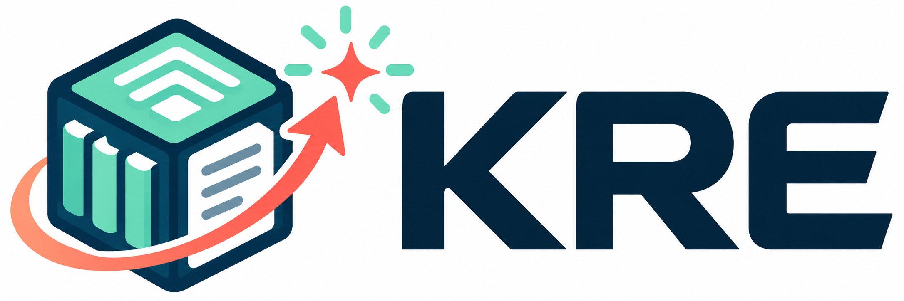
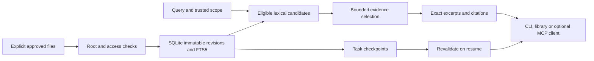

<p align="center">
  
</p>

# KRE · Knowledge Retrieval Engine

**Local evidence. Exact provenance. Bounded context.**

KRE searches approved text and Markdown documents, returns source-cited excerpts,
and revalidates evidence when documents or tasks change. It uses Python and SQLite
FTS5 with **zero runtime dependencies**. No model, embeddings, cloud account,
background server or companion package is required.

Version **0.3.2a1** is an experimental alpha. KRE is useful for local
project knowledge and explicit task continuity. Lexical retrieval can miss
paraphrased or dispersed evidence; a successful search does not prove an answer is
complete. General quality-preserving token or cost savings have **not** been established.

## Five-minute quickstart

From the source checkout on a supported POSIX system with Python 3.11+ and SQLite FTS5:

```sh
python3 -m venv .venv
. .venv/bin/activate
python -m pip install .
kre --version
kre demo
kre search rollback
kre context rollback --budget 3000 --max-bytes 3000
kre demo-k2
```

The demos use bundled fictional documents and create `.kre/knowledge.sqlite3` in
the current directory. They make no model or network calls. Package installation
may obtain build dependencies; the installed application needs none. An approved
wheel can also be installed offline with `python -m pip install --no-index --no-deps WHEEL_PATH`.

`demo-k2` demonstrates immutable updates, revocation, required evidence and task
resume. To verify the complete installed workflow in temporary storage:

```sh
python -I scripts/verify_user_workflow.py
```

## Add your project knowledge

```sh
kre init
kre ingest docs/runbook.md docs/notes.txt --root docs
kre search "rollback approval"
kre context "rollback approval" --budget 4000 --max-bytes 4000 --max-items 5
kre status
```

Choose files explicitly. KRE supports UTF-8 `.txt`, `.md` and `.markdown`; it does
not recursively crawl directories. `--root` limits allowed filesystem access and
descendant symlinks are rejected. Use `kre --db PATH COMMAND` for a separate store.

Search prints excerpts with line citations. Context returns JSON with evidence,
provenance, policy labels and accounting. **Inject `context_text` once** when
building a model prompt; `items` describes the same excerpts for inspection and
must not be appended again as additional evidence.

`--budget` is a conservative local estimate counted as UTF-8 bytes, not a provider
tokenizer. The separate byte and item ceilings are also enforced. The caller must
budget the rest of the model prompt and tools. If a known required excerpt cannot
fit, `context_required` returns an explicit error and empty context instead of
silently removing it.

## Keep evidence current

```sh
kre inspect REVISION_ID
# Edit an approved file, then ingest that same file again:
kre ingest docs/runbook.md --root docs
kre lifecycle SOURCE_ID --action revoke
kre task-checkpoint review --card task.json
kre task-resume review
```

Ingestion returns the source/revision IDs. Updates create immutable successor
revisions; citations to previous revisions remain inspectable. Normal retrieval
excludes superseded, stale, revoked and deleted evidence. Historical mode can
include superseded/stale evidence, but never revoked or deleted material.

Task cards preserve an objective, constraints, decisions, questions, next actions
and exact evidence references. Resume revalidates those dependencies and removes
invalid evidence **and its dependent prose**. It does not invent summaries or
facts. See the [user guide](docs/USER_GUIDE.md) for a runnable citation/checkpoint
example, freshness controls and removal.

## How it fits together



KRE retrieves evidence; your application owns model execution, tool permissions
and final answer validation. Source content is untrusted data, not instructions
that grant authority.

## Optional assistant integration

`python -m kre.mcp` exposes `kre_retrieve` and `kre_validate` over MCP stdio. An
existing client starts the child process; no network listener is installed. The
operator fixes the database, collection, principal, destination and budget.
There is no ingestion or lifecycle-editing tool exposed to an assistant by default.

Read the [MCP/OpenClaw setup guide](docs/MCP.md) before enabling it. A local MCP
process can still send results to a cloud-hosted assistant: local execution does
not establish a local destination. Generic MCP does not prove an individual
agent's identity or enforce downstream model routing. No live OpenClaw settings
are changed by installing KRE.

## Evidence, performance and limitations

KRE separates three questions: can it retrieve authorized evidence, can it select
sufficient bounded context, and does it improve the whole AI workflow? Success on
the first two does not prove the third.

The retained experiment measured 96 local inference calls: 24 synthetic tasks,
two conditions and two models. It exposed missing evidence and compact-document
overhead; those failures remain in the record.

| Model / baseline | Pairs | Total tokens without → with KRE | Observed token reduction |
|---|---:|---:|---:|
| Qwen 9B / complete documents | 6 | 20,478 → 21,927 | −7.08% |
| Qwen 9B / constrained FTS5 windows | 18 | 85,384 → 69,647 | 18.43% |
| Qwen 35B / complete documents | 6 | 20,519 → 21,867 | −6.57% |
| Qwen 35B / constrained FTS5 windows | 18 | 83,956 → 70,588 | 15.92% |

These are measured consumption differences, **not established quality-preserving
savings**. Original supplied-evidence coverage was 60/63 without versus 53/63 with
KRE. All 96 independent human semantic judgments remain pending; 35B tasks LS04
and LS05 mechanically regressed. Later offline retrieval corrections do not
change those answers or prove new model-token savings. The baseline types are
reported separately; neither tests an unrestricted advertised model context.

A focused follow-up retrieval prototype was rejected: it increased context, did
not improve new held-out recall and regressed a tight-budget case. The alpha
retains the verified runtime rather than shipping an unproven change.

See [benchmark methods and results](docs/BENCHMARKS.md), the
[historical per-task report](docs/benchmarks/historical-96.md) and
[known limitations](docs/LIMITATIONS.md). Performance claims are scoped to their
corpus, runtime, hardware and measurement method.

## Compatibility and verification

The CLI, library and bounded MCP protocol are independently usable. The current
local release verification runs on macOS arm64; other OS/Python combinations are
claimed only after their required checks execute. A declared CI matrix is not a
passed platform test. Windows file ingestion is not supported by the current
POSIX descriptor-relative safety implementation.

```sh
python -m unittest discover -s tests -v
python -I scripts/verify_user_workflow.py  # after installing the package
```

See [compatibility](docs/COMPATIBILITY.md), [executed verification](docs/VERIFICATION.md) and [security/privacy](SECURITY.md).
Private operational evidence and development history are not required to install
or use the public package.

## Works Well With

[Governed Capability Broker (GCB)](https://github.com/Leogy101/governed-capability-broker)
selects execution paths and models using capability evidence and policy. KRE
supplies authorized, provenance-aware context. Their versioned context contract
is compatible through offline fixtures; **neither project requires the other**.

## Contributing

Keep changes small, preserve exact citations and authorization boundaries, and
report coverage and context consumption together. See [CONTRIBUTING.md](CONTRIBUTING.md).
KRE is licensed under [Apache-2.0](LICENSE), with designated CC0 benchmark data
and shared-component attribution described in [LICENSING.md](LICENSING.md) and
[NOTICE](NOTICE). The [owner-supplied KRE logo](docs/assets/README.md) is included
without external font or service dependencies.
