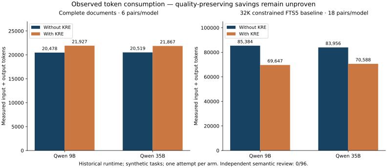

# Benchmark methodology and evidence

Measure three different properties separately:

1. **Retrieval:** authorized sources, required evidence, exact citations and source selection.
2. **Context selection:** coverage within the requested byte/item budget, duplication,
   unnecessary material and explicit failures.
3. **Whole-workflow efficiency:** actual model usage/time/cost with preserved task quality.

Success on the first two does not establish the third. Estimated context tokens
are not provider-reported usage, and smaller serialization is not monetary savings.

## Historical real-model experiment

The [retained result report](benchmarks/historical-96.md) and
[machine-readable projection](benchmarks/historical-96.json) cover every one
of the 96 original local inference attempts. The projection contains raw-answer
hashes, exact strata and mechanical scores; it excludes private operational logs.

- 24 frozen synthetic tasks, 72 synthetic documents, two conditions and two models.
- `qwen3.5:9b` and `qwen3.6:35b-a3b`, each with `think:false`.
- 32K requested context and 1,536 output-token ceiling; one attempt per arm,
  no answer repair or retry.
- Six complete-document tasks and 18 constrained FTS5-window baseline tasks per
  model. Never pool these baseline types into a generalized savings headline.
- Input/output and separately reported cached tokens come from final Ollama
  responses. Missing reasoning usage and actual charges remain unknown.
- Exact submitted message bytes, retrieval latency, inference, preload and cleanup
  are distinguished. Receipt completion duration before cleanup is not full-arm
  wall time; both are available in the JSON.
- Frozen required evidence, JSON/schema and exact-quotation gates were applied to
  every answer. They are not a substitute for semantic correctness.

Original evidence coverage was 60/63 baseline and 53/63 treatment. All 96 human
semantic judgments are pending. Lower observed consumption on some tasks does
not establish quality-preserving savings. The seven treatment evidence failures,
compact-document overhead, and LS04/LS05 mechanical regressions remain visible.
One sample per arm over a selected synthetic corpus is not a population or
statistical-significance claim.

## Offline retrieval evidence

The retained runtime later supplied 63/63 required items on the known task set,
with 51.25% more model-visible context than the preceding implementation. That is
an offline coverage/context tradeoff, not a new inference result.

On a newly introduced fragmented suite, it supplied 17/32 strict spans. Five
additional spans contained the annotated nonblank text but failed blank-line
fidelity; four were correctly withheld by destination policy; six substantive
passages were missing within already-found sources. These disjoint diagnostic
categories do not revise the frozen 17/32 score. They explain why a passing known
suite cannot establish general retrieval reliability.

Any alpha correction must be evaluated against both retained cases and separately
frozen, independently authored held-out cases, with unchanged scoring. Report
strict recall, source precision, bytes/estimated tokens, citation accuracy,
latency, policy/lifecycle behavior and tight-budget failures together. A rejected
prototype does not become a shipped feature. No further live-model result is
implied by this preparation.

## Alpha preparation decision: keep the retained runtime

A focused deterministic same-source passage-selection prototype was evaluated
and rejected. It did not generalize enough to justify shipping:

| Offline suite / metric | Retained runtime | Prototype |
|---|---:|---:|
| New independent ordinary-case strict spans | 24/28 | 24/28 |
| New independent ordinary-case context bytes | 34,923 | 35,651 (+2.08%) |
| New independent exact citations | 42/42 | 42/42 |
| New independent source precision | 15/21 | 15/21 |
| Known benchmark strict evidence | 63/63 | 63/63 |
| Known benchmark context bytes | 286,022 | 304,009 (+6.29%) |
| Previously diagnosed fragmented strict spans | 17/32 | 26/32 |
| Previously diagnosed fragmented context bytes | 37,381 | 47,462 (+26.97%) |
| Known benchmark strict evidence at 4,000-byte budget | 59/63 | 58/63 |

Policy and budget checks passed, and continuity remained correct. The prototype
improved already-known fragmented cases at higher context cost, added no strict
coverage on newly authored ordinary cases, and regressed one tight-budget item.
The alpha therefore retains the runtime from `8318473`; no retrieval architecture
change or larger-context workaround is shipped. This supports a narrow
provenance-aware lexical alpha, not automatic comprehensive evidence retrieval.

## Independent answer review

The unchanged review packet contains 96 raw answers, frozen questions and rubric,
required facts/constraints, evidence alternatives and 72 source snapshots. An
independent human reviews every answer with model/condition identities hidden.
A second human adjudicates uncertainty and the frozen 20-answer sample: LS01,
LS05, LS08, LS16 and LS23 across all arms/models. The original key stays separate
until judgments are locked; answer style may still provide clues.

Semantic correctness, unsupported claims, missing constraints, citation-to-claim
support and task completion remain unknown until that process occurs. Default
human/independent/blinded flags in empty forms are not completed review. Valid
evidence outside the frozen oracle is an explicit dispute, not permission to
silently revise original scoring.

## Reproduction scope

`python -I scripts/verify_user_workflow.py` verifies installed product behavior
with synthetic local files and the real MCP stdio process. It is an installation
check, not an inference benchmark. Public offline evaluation fixtures and their
hashes accompany the release when included; reruns must identify runtime and
fixture versions and preserve held-out boundaries.

The public result projection is a sanitized historical derivative. Complete raw
execution and operational archives remain private; they are not installation
prerequisites or part of the public Git history. No automatic live benchmark is
provided or authorized by these documents.

See the [locked proposal and adoption decision](alpha/RETRIEVAL_DECISION.md) and [independent offline evaluation](../evaluation/alpha-readiness-v1/REPORT.md).

